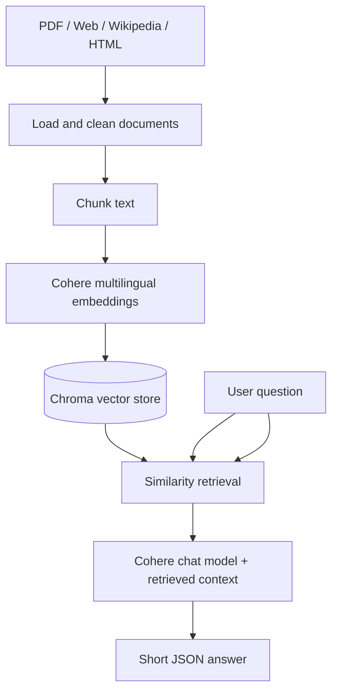

<div align="center">

# LibreChat

**Document-grounded question answering about Linux, GNU, and free software**


*A learning project exploring multilingual retrieval-augmented generation (RAG).*

</div>


## Overview

LibreChat explores how to build a question-answering system grounded in information collected from **PDFs, websites, Persian Wikipedia, and local HTML files**. The subject matter is Linux, the GNU Project, free software, and the people who helped shape them.

Rather than ask a language model to answer from memory alone, the pipeline retrieves relevant passages from a local vector store and provides them as context to a language model. This can improve grounding, but **does not guarantee factual accuracy**.

> **Project status:** Coursework / educational prototype. The documented components were exercised in Jupyter; this repository package is publication scaffolding, **not a claim that a deployed chatbot, web interface, automated tests, or full EPUB ingestion already exists**. Add your original notebook/source files before describing them as implemented.

## Highlights

- Multi-source document loading with LangChain loaders
- Persian text cleanup, including normalization of selected extraction artifacts
- Chunking with `RecursiveCharacterTextSplitter`
- Multilingual embeddings using Cohere (`embed-multilingual-v3.0`)
- Persistent local vector storage with Chroma
- Similarity retrieval and concise answer generation using Cohere chat
- JSON-formatted question-answering output

## Architecture



### Processing stages

| Stage | Example tools | Purpose |
| --- | --- | --- |
| Load | `PyPDFium2Loader`, `WebBaseLoader`, `WikipediaLoader`, `DirectoryLoader` + `BSHTMLLoader` | Collect source content |
| Clean | Python / regular expressions | Normalize selected Persian glyphs and whitespace |
| Split | `RecursiveCharacterTextSplitter` | Create overlapping text chunks |
| Embed | `CohereEmbeddings` | Encode chunks and queries |
| Store | `Chroma` | Persist indexed chunks |
| Retrieve | Chroma retriever | Find relevant context |
| Answer | `ChatCohere` + LangChain | Return a concise response |

## Getting started

### Prerequisites

- Python 3.10 or later (check compatibility with your installed LangChain versions)
- A Cohere API key with access to the selected models
- Network access to Cohere and any public sources you want to load
- Input documents you have permission to use

### Installation

```bash
git clone https://github.com/YOUR_USERNAME/LibreChat.git
cd LibreChat
python -m venv .venv
```

On **Windows**:

```powershell
.venv\Scripts\Activate.ps1
python -m pip install -r requirements.txt
```

On **macOS/Linux**:

```bash
source .venv/bin/activate
python -m pip install -r requirements.txt
```

Copy `.env.example` to `.env`, then set your Cohere API key. Never commit `.env` or credentials.

```bash
python -m notebook
```

**Important:** The original course notebooks are **not included** in this publication package. Add them under `notebooks/` before following notebook-based instructions. The package contains documentation and publication assets, not a complete turnkey application.

## Illustrative usage

After building your retriever and `rag_chain` in a notebook:

```python
result = rag_chain.invoke({
    "question_number": 1,
    "question": "ریچارد استالمن چه کسی است؟",
})
print(result)
```

Expected **shape** of output (example only; not an evaluated answer):

```json
{
  "question_number": 1,
  "answer": "پاسخ کوتاه"
}
```

Do not treat this example as runnable in isolation: `rag_chain` must be created first, and relevant documents must already be indexed.

## Operational notes

**Cohere rate limits.** Trial keys may encounter HTTP 429 token- or request-rate limits. Start with a small document batch, implement paced ingestion, and resume with stable document IDs to avoid duplicates.

**Network and proxies.** A 403 HTML response is not necessarily an invalid API key; proxy or network routing may cause it. Diagnose direct API requests before changing pipeline code. Keep proxy addresses and credentials out of commits.

**Persian extraction.** Some PDFs can yield broken Unicode sequences. Clean cautiously and verify samples against the source: blanket character replacement can corrupt legitimate text.

**Retrieval quality.** Check the number of actually stored chunks. A partially populated Chroma collection may lead to missing or unsupported answers.

## Repository layout

```text
LibreChat/
├── assets/
│   └── poster.svg
├── data/
│   └── README.md
├── docs/
│   └── PROJECT_DESCRIPTION.md
├── notebooks/
│   └── README.md
├── .env.example
├── .gitignore
├── CONTRIBUTING.md
├── LICENSE
├── README.md
├── SECURITY.md
└── requirements.txt
```

## Scope and roadmap

**Current educational workflow:** loading, preprocessing, chunking, embeddings, local vector retrieval, and structured question answering.

**Potential extensions (not implemented in this package):** EPUB ingestion, source-level citations, automated retrieval evaluation, web interface, conversational memory, Docker deployment, and a service API.

## Data and attribution

This repository does not redistribute third-party books or downloaded articles. Respect document licenses, source attribution, and website access policies before collecting or publishing content.

## Contributing

See [CONTRIBUTING.md](CONTRIBUTING.md) for contribution guidelines. Suggestions and issue reports are welcome.

## License

The original code and documentation in this starter package are intended for release under the [MIT License](LICENSE), once the copyright holder is filled in. **Third-party source content has separate rights and is not automatically covered by MIT.**

## Acknowledgments

Inspired by the Linux ecosystem, the GNU Project, the free software movement, and the course exercise from which this project originated.
